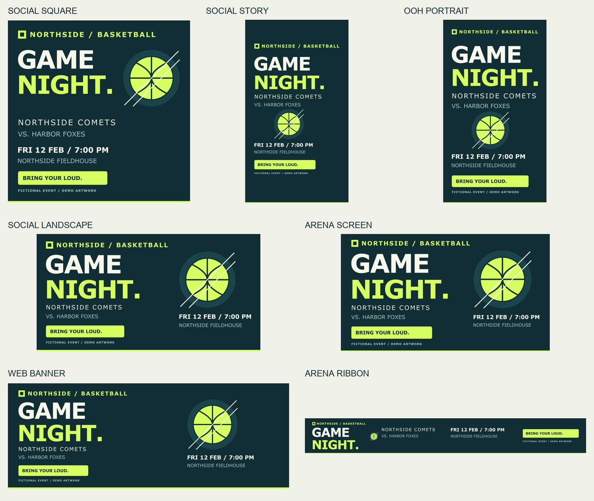

# Creative asset toolkit

I built a promotion artwork exporter because resizing the same design for a square post, a tall sign and a wide screen meant repeating edits and checking every file by hand. I wanted to change the game details once and get a clearly named folder I could hand to someone else.

I edit one drawing, then run one command to make **14 files across seven sizes** for social posts, a website, outdoor digital signs and arena screens. The toolkit rearranges the artwork to fit each shape and checks that the text stays inside the safe area, the space clear of screen edges or interface overlays. The included basketball event, teams and venue are fictional.

To try it, install the tools below, then run `python -m toolkit.export` inside the project environment. Open `dist/game-night-v01/` to see the images and `manifest.json`, the delivery checklist with each file's size, format and pass/fail status.



## Run it

I use Inkscape for the editable drawing and rendering, and GIMP 3 for the final image exports. These are open-source alternatives to Illustrator and Photoshop. Python runs the steps without opening either editor's interface.

On macOS, with [Homebrew](https://brew.sh/) installed:

```sh
brew install --cask inkscape gimp
git clone https://github.com/jackaI1/creative-asset-toolkit.git
cd creative-asset-toolkit
python3 -m venv .venv
source .venv/bin/activate
pip install -r requirements-dev.txt
python -m toolkit.export
```

On Debian 13, install the graphics tools with the following command, then use the same clone and Python commands above:

```sh
sudo apt-get update
sudo apt-get install inkscape gimp gir1.2-gimp-3.0 python3-gi python3-gi-cairo python3-venv fonts-dejavu-core
```

GIMP **3.x** is required; GIMP 2 uses a different scripting interface. Inkscape 1.4 or newer is recommended. On macOS the exporter also finds the apps in `/Applications`. For other locations, set `INKSCAPE_BIN` and `GIMP_BIN` to their executable paths.

## Change the promotion

1. Open [assets/game-night.svg](assets/game-night.svg) in Inkscape. Change the headline, teams, date or colours. Keep the six named groups: `brand`, `headline`, `matchup`, `event`, `cta` and `art`.
2. Edit [config/targets.json](config/targets.json) to change the campaign name, revision or output sizes. Safe-area values are pixel insets in left, top, right, bottom order. They are my example delivery rules; check the actual screen owner's requirements.
3. Run a new export into an unused folder:

```sh
python -m toolkit.export --output dist/game-night-v02
```

Change `revision` to `v02` in the configuration too if the filenames should carry that revision. The exporter refuses an existing output folder so I cannot accidentally mix old and new deliveries. To use a different drawing or configuration:

```sh
python -m toolkit.export --master assets/game-night.svg --config config/targets.json --output dist/custom
```

| Delivery preset | Pixels | Example safe insets, L/T/R/B |
| --- | --- | --- |
| Social square | 1080 × 1080 | 60 / 60 / 60 / 60 |
| Social story | 1080 × 1920 | 96 / 250 / 96 / 300 |
| Social landscape | 1200 × 630 | 50 / 40 / 50 / 40 |
| Web banner | 1600 × 600 | 60 / 40 / 60 / 40 |
| Outdoor digital sign | 1080 × 1920 | 90 / 100 / 90 / 100 |
| Arena screen | 1920 × 1080 | 96 / 54 / 96 / 54 |
| Arena ribbon | 3840 × 480 | 100 / 40 / 100 / 40 |

Each preset produces a PNG and a JPEG. For example, `northside-game-night_arena-screen_1920x1080_v01.jpg` tells me the campaign, destination, dimensions and revision without opening the image.

## What gets checked

The drawing is an SVG, a file made of editable shapes and text. Inkscape measures the actual rendered edges of each group, including text and strokes. Python fits those groups into portrait, square, landscape or ribbon arrangements, measures them again and rejects any group outside its safe area. It does not stretch the text or crop away event details.

GIMP loads the renders, flattens them onto the drawing's background, uses RGB colour and 96 pixels per inch, and exports compressed PNGs plus JPEGs at 92% quality. The script disables source metadata such as comments and location information. A separate temporary GIMP profile and a new process keep the batch separate from an open editing session.

The manifest records the source drawing's fingerprint, tool versions, content bounds, safe insets, dimensions, format, byte count and SHA-256 fingerprint for each file. A fingerprint lets someone check that a delivered file has not changed. A failed run returns a nonzero exit code and writes a failed manifest once the export folder has been created. Only use a folder whose manifest says `passed`.

I still inspect the images before delivery. Fitting text inside a margin does not prove it is readable from the back of an arena. These are still images for digital screens, with no animation, print bleed or printer colour conversion. Fonts can vary between computers; I use DejaVu Sans where available. The [design notes](docs/design.md) explain the layout and hand-off details.

## Tests and automation

```sh
python -m pytest -q
```

The suite includes real Inkscape and GIMP exports, verifies all 14 files, and checks that a longer team name still fits. It also covers invalid configuration, unsafe bounds, wrong image formats and dimensions, existing-folder protection and failed manifests. Graphics integration tests skip if the tools are absent; set `ASSET_REQUIRE_TOOLS=1` to make missing tools a failure.

[GitHub Actions](https://github.com/jackaI1/creative-asset-toolkit/actions) installs both editors in Debian 13, runs the tests, then exports a complete delivery folder. Each successful run offers a `northside-game-night-delivery` download under Artifacts. The initial implementation passes **40 tests**, including 14 checks of full-size delivery files. The repository started with no existing tests or executable features.
